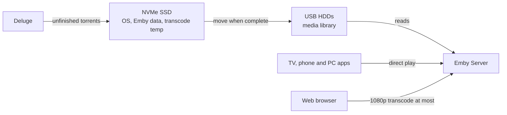

# deluge-and-emby-media-server

A Raspberry Pi 5 media server running Emby, with Deluge downloading on the same box. This repo has the settings that make it play smoothly, the config files to copy, and `emby-tune`, a script that checks any Emby server and fixes the usual problems. The Pi 5 is the reference build, but the settings and the script work on any Linux Emby host.

## The setup

| Part | What | Notes |
|---|---|---|
| Board | Raspberry Pi 5, 8 GB | official 27 W PSU, active cooler, wired Ethernet |
| System disk | NVMe SSD on an M.2 HAT | OS, Emby data, transcode temp, unfinished downloads |
| Media disks | USB 3 hard drives, ext4 | finished media only, mounted with `noatime` |
| OS | Raspberry Pi OS 64-bit (Debian 12 bookworm) | |
| Media server | Emby Server 4.10, native `.deb` | libraries: Movies, Series, Anime |
| Downloads | Deluge 2 daemon (`deluged`), systemd service | seeds from the library folders |
| Players | Emby apps on TVs, phones, PCs; web browser | remote users through the internet |



## Goals

| # | Goal | How | Guide |
|---|---|---|---|
| 1 | Transcoding that works on a CPU-only Pi | throttling on, no HEVC encoding, transcodes capped at 1080p, 4K left for direct play | [Pi 5](docs/raspberry-pi-5.md), [Emby](docs/emby-settings.md#transcoding) |
| 2 | Content identified correctly | TheTVDB/TheMovieDb first, AniDB rate-limited for anime, series spread over season folders merged | [Emby](docs/emby-settings.md#metadata) |
| 3 | Subtitles downloaded automatically in two languages (e.g. English and Brazilian Portuguese) | Open Subtitles plugin with the account username, forced-only and hash-match off | [Emby](docs/emby-settings.md#subtitles) |
| 4 | Movies, series and anime start in their original language | audio preference list without the dub language, file default flag ignored | [Emby](docs/emby-settings.md#original-language-audio) |
| 5 | Users can download for offline viewing | media downloading allowed per user | [Emby](docs/emby-settings.md#downloads-for-offline-playback) |
| 6 | Smooth playback at home and remotely | downloads kept off the media disks, BFQ disk scheduler, direct-play clients for 4K | [Deluge](docs/deluge-with-emby.md), [Pi 5](docs/raspberry-pi-5.md#linux-disk-tuning) |
| 7 | No settings that don't suit a Pi 5 | no hardware encoding or tone mapping, heavy tasks at night, Emby kept up to date | [emby-tune](docs/emby-tune.md) |
| 8 | Emby and Deluge can both read and write the media | shared `media` group, setgid folders with default ACLs, group-writable umask, services wait for the USB disks | [Permissions](docs/permissions.md) |

## Quick start

You need two things from your own server:

1. **Its internal IP.** Run `hostname -I` on the Pi; the first address (something like `192.168.1.50`) is the one. The script only accepts internal or VPN addresses, never a public IP.
2. **An admin API key.** In Emby: Dashboard > Advanced > API Keys > New.

Then run this on the Pi (running it from another computer works too, but skips the Deluge and disk checks). `emby-tune` is a Ruby script that uses only the standard library. If Ruby isn't installed (Raspberry Pi OS doesn't ship it), the one-liner offers to run `sudo apt-get install ruby` first.

```bash
curl -fsSL https://raw.githubusercontent.com/patrickemuller/deluge-and-emby-media-server/main/install.sh | bash
```

It asks for the IP and the key, shows what it found and what it would change, and changes nothing until you confirm. To reproduce the full setup above in one go, replace the IP and the server name with your own:

```bash
curl -fsSL https://raw.githubusercontent.com/patrickemuller/deluge-and-emby-media-server/main/install.sh | bash -s -- \
  --host 192.168.1.50 --server-name 'Home Cinema' \
  --subtitle-langs en,pt-br --original-audio --allow-downloads
```

Add `--dry-run` to only look, or run `benchmark` to measure what your machine can transcode. All the flags are in [docs/emby-tune.md](docs/emby-tune.md).

## Config files

Copy these if you'd rather set things up by hand. `emby-tune` writes the same files and fills in your own mount points.

| File | Install to | Does |
|---|---|---|
| [`config/udev/60-media-hdd-iosched.rules`](config/udev/60-media-hdd-iosched.rules) | `/etc/udev/rules.d/` | BFQ scheduler and 4 MB readahead on spinning disks |
| [`config/sysctl/60-media-writeback.conf`](config/sysctl/60-media-writeback.conf) | `/etc/sysctl.d/` | caps unwritten data at 256 MB so flushes don't stall reads |
| [`config/systemd/deluged.service.d/10-low-io-priority.conf`](config/systemd/deluged.service.d/10-low-io-priority.conf) | `/etc/systemd/system/deluged.service.d/` | Deluge at idle disk priority |
| [`config/systemd/*/20-media-access.conf`](config/systemd/emby-server.service.d/20-media-access.conf) | `/etc/systemd/system/emby-server.service.d/` and `deluged.service.d/` | group-writable umask; don't start before the media disks are mounted |
| [`config/fstab/media-drives.fstab.example`](config/fstab/media-drives.fstab.example) | lines for `/etc/fstab` | mount by UUID with `noatime` and `nofail`; ownership options for NTFS/exFAT drives |
| [`config/deluge/recommended-settings.json`](config/deluge/recommended-settings.json) | `./emby-tune.rb deluge-apply config/deluge/recommended-settings.json` | downloads to SSD, move when complete, 2 active downloads |

The shared group and folder permissions are commands, not files; they're in [docs/permissions.md](docs/permissions.md). After copying the files:

```bash
sudo udevadm control --reload && sudo udevadm trigger --subsystem-match=block --action=change
sudo sysctl -p /etc/sysctl.d/60-media-writeback.conf
sudo systemctl daemon-reload && sudo systemctl restart emby-server deluged
```

## Guides

- [Emby settings, by hand](docs/emby-settings.md)
- [Running Deluge next to Emby](docs/deluge-with-emby.md)
- [Raspberry Pi 5 as an Emby server](docs/raspberry-pi-5.md)
- [Letting Emby and Deluge share the media folders](docs/permissions.md)
- [emby-tune reference](docs/emby-tune.md)

## Tested with

Emby Server 4.10.2, Deluge 2.0.3, Raspberry Pi OS (Debian 12 bookworm), Raspberry Pi 5 8 GB, Ruby 3.1.

## License

[MIT](LICENSE)
