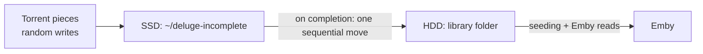

# Running Deluge next to Emby

If a torrent client and Emby share a hard drive, downloads usually win and streams buffer. Torrents write pieces in random order all over the disk, and a single USB hard drive can't serve random writes and a 50 Mbps sequential read at the same time.

What I measured on a Pi 5 with a 2 TB USB drive, with torrents downloading at 10-15 MB/s to the same disk Emby read from. A 4K stream needs about 1x; anything below that buffers.

| Reading 4K video from that disk | Speed (1.0x = real time) |
|---|---|
| 4 downloads, no tuning | 0.10x |
| 2 downloads, BFQ + idle priority, first file | 1.63x |
| 2 downloads, BFQ + idle priority, second file an hour later | 0.37x |

Priority tuning helps, but not reliably. Linux writes Deluge's data to disk later, from kernel flush threads, and those writes don't carry Deluge's idle priority. The only reliable fix is to keep downloads off the disk Emby reads from, which is step 1 below.

## The setup



1. **Download to an SSD, move when complete.** In Deluge > Preferences > Downloads set "Download to" to a folder on the SSD/NVMe, tick "Move completed to", and point it at your library folder. Keep at least the size of your largest active downloads free on the SSD; filling the root disk takes the whole box down.
2. **Limit active downloads.** Preferences > Queue: "Total active downloading" 2. Fewer torrents writing at once finish sooner.
3. **Give Deluge the lowest disk priority.** Copy [`10-low-io-priority.conf`](../config/systemd/deluged.service.d/10-low-io-priority.conf) to `/etc/systemd/system/deluged.service.d/`, then `sudo systemctl daemon-reload && sudo systemctl restart deluged`. The idle class only does anything with the BFQ scheduler; see [the Linux tuning](raspberry-pi-5.md#linux-disk-tuning).
4. **When adding a torrent**, leave "Download to" at the default and change only "Move completed to" (Movies, Series, Anime...). Downloading straight into a library folder lets Emby scan half-written files.
5. **Give Deluge and Emby a shared group** so files Deluge writes stay editable by Emby (subtitles, artwork, deletes) and the other way round. See [Letting Emby and Deluge share the media folders](permissions.md).

## Don't touch seeded files

If you seed from the library, renaming, remuxing or editing tags (`mkvpropedit`) changes the data the torrent hashes. Deluge then serves corrupt pieces or re-downloads them. Fix naming and metadata in Emby, not in the files. Moving a torrent is fine if you use Deluge's "Move storage".

## Scripting Deluge

`deluge-console "config -s download_location /path"` fails on Deluge 2.0.x (`'str' object has no attribute 'decode'`); booleans and numbers work, strings don't. `emby-tune` talks to deluged's RPC port directly instead: TLS on port 58846, with each message zlib-compressed rencode, implemented in plain Ruby. To apply [`recommended-settings.json`](../config/deluge/recommended-settings.json), edit the paths in the JSON first, then:

```bash
./emby-tune.rb deluge-apply config/deluge/recommended-settings.json
```

It reads deluged's `localclient` login from the daemon user's `~/.config/deluge/auth`, using `sudo` if that file belongs to another user, and prints the values Deluge now has.
