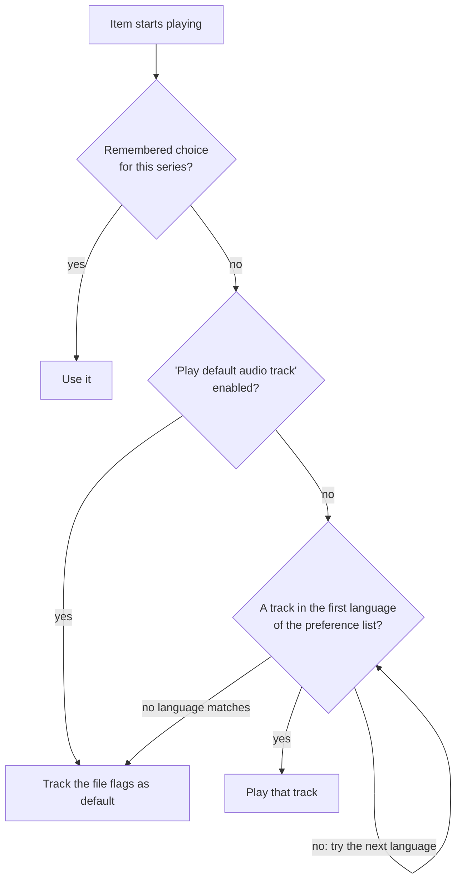

# Emby settings, by hand

These are the settings `emby-tune` checks, with the dashboard path for each, so you can set them yourself or understand what the script changed. Paths are from Emby 4.10.

## Transcoding

Dashboard > Transcoding.

Turn on **throttling** on every server. Emby then pauses ffmpeg once it has enough video buffered ahead of the player, and the CPU it frees goes to other streams.

If the hardware acceleration list is empty, every transcode runs on the CPU. That's the case on a Raspberry Pi 5 (no hardware encoder, and Emby can't use its HEVC decoder) and on most cheap ARM boards. On those machines:

| Setting | Value | Reason |
|---|---|---|
| Enable HEVC encoding | off | software x265 runs below real time at 1080p |
| Max transcoding resolution | 1920 wide | stops 4K being re-encoded into 4K H.264, which is about 3x too slow |
| Hardware encoding | off | there is nothing to use |
| Tone mapping | off | HDR to SDR in software is far too heavy |
| Transcoding temp path | an SSD folder | segments are written constantly while transcoding |

A CPU-only box still can't transcode 4K HEVC at all; decoding alone is slower than real time. Those files need clients that play them directly: the Emby apps for Android TV, LG, Samsung, Apple TV and Windows. The Chrome web player can't play HEVC, so it always asks for a transcode. Run `emby-tune benchmark` to see the numbers for your machine.

## Subtitles

### Open Subtitles login

Dashboard > Plugins > Open Subtitles. Use your opensubtitles.com **username**, not the email you sign in with on the website. With an email the API returns 400 on `/login`, and the log fills with "OpenSubtitles authentication failed".

Free accounts get a small number of downloads per day, VIP accounts many more. The nightly "Download subtitles" task picks up where it stopped the next day.

### Library options

Each library > Manage library > Subtitle downloads:

| Option | Value | Reason |
|---|---|---|
| Download languages | e.g. English, Portuguese (Brazil) | nothing downloads without at least one |
| Subtitle downloaders | Open Subtitles enabled | |
| Only download forced subtitles | off | when on, only foreign-dialogue tracks are fetched, so almost nothing comes down |
| Require a hash match | off | only byte-identical files match; most releases never do |
| Skip if the video already has embedded subtitles | on | saves quota |

Language codes differ by screen. Library download languages use two-letter codes (`en`, `pt-br`). User preferences use ISO 639-2 three-letter codes: `eng`, `por`, and `pob` for Brazilian Portuguese. Downloaded pt-BR files are saved as `*.pt-br.srt` and show up as Portuguese (Brazil).

A track tagged plain `por` does not count as pt-BR, so pt-BR subtitles still download for files that already have a `por` track.

## Original-language audio

Emby has no "original language" option. It picks audio like this:

Dual-audio releases usually flag the dubbed track as default. Brazilian releases, for example, put Portuguese first and mark it default. The fix:

1. Each user > Playback: turn off **Play default audio track regardless of language**.
2. Set **Preferred audio language** to a comma-separated list that does *not* include your dub language, e.g. `jpn,kor,chi,eng`.

A file with Portuguese + English then plays English, Portuguese + Japanese plays Japanese, and a Japanese film with English, French and German dubs plays Japanese. The dashboard only shows a single dropdown, so set the list with `emby-tune --audio-pref` or through the API.

Two caveats:

- "Remember audio selections" wins over the list. Once someone picks a track for a series, later episodes keep that choice.
- A non-English original with an English dub (a French film with French + English tracks) plays English, because `eng` is in the list and `fre` isn't. Put that language before `eng` if this matters to you.

Pair it with a subtitle preference. "Smart" mode shows subtitles only when the audio isn't in your subtitle language. A Brazilian viewer would use `pob,por` with Smart.

## Metadata

- **Series split across season folders** (`Show.S01...`, `Show.S02...`): leave "Automatically merge series that are spread across multiple folders" on and they show as one series. Renaming folders breaks seeding if your torrent client seeds from them.
- **Anime**: TheTVDB first, AniDB as a fallback. In the Anime plugin, set the AniDB wait time to 2500 ms or more; AniDB bans IPs that send more than one request every 2 seconds.
- **Metadata country** (Dashboard > Library > Metadata) controls ratings and release dates. Set it to where your viewers live, and override it per library only when needed (e.g. Japan for an anime library).

## Downloads for offline playback

Each user > Access > **Allow media downloading**. The mobile and TV apps also need an active Emby Premiere subscription on the server. "Allow downloads with conversion" makes the server transcode the download, which is slow on a CPU-only box; downloading the original file is instant.

## Remote access

Emby over plain HTTP sends logins and access tokens unencrypted. Put it behind a reverse proxy with HTTPS (Caddy, nginx) or reach it through a VPN (WireGuard, Tailscale). Remote bandwidth is your upload speed: a 4K remux needs 50-80 Mbps upstream, and if that's too much, the server transcodes, which a CPU-only box can't do for 4K.
